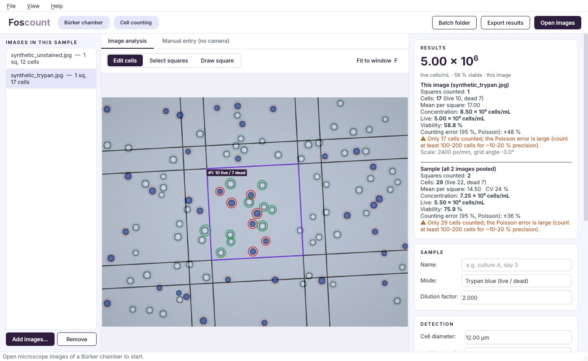

# Foscount

Foscount is a desktop app that counts cells automatically in microscope photos of a **Bürker counting chamber**. It works for unstained samples and for **trypan blue live/dead** counts.



## Download (Windows)

Get the latest version from the **[Releases page](https://github.com/Baboe/burkercell/releases/latest)**:

- **`Foscount-Setup-x.y.z.exe`**: installer with Start-menu and desktop shortcuts. No administrator rights are needed. Recommended.
- **`Foscount-portable-x.y.z.exe`**: a single file that runs without installing. It starts more slowly.

The app is not code-signed yet, so Windows SmartScreen may show a warning. Click **More info → Run anyway**.

## What it does

- **Detects the Bürker grid automatically**, including its rotation and scale (px/mm). It selects every *complete* large square (0.2 × 0.2 mm).
- **Counts cells** in the selected squares using the standard rule: cells touching the top or left line are counted, cells touching the bottom or right line are not.
- **Two modes**
  - *Unstained*: counts all cells.
  - *Trypan blue*: classifies each cell as live (clear) or dead (blue/dark). A slider adjusts the threshold.
- **Concentration**: cells/mL = mean per large square × dilution ÷ 0.004 µL. For a standard chamber that is mean × dilution × 250 000. With trypan blue it also gives live cells/mL and viability %. A 95 % Poisson counting error is shown, along with warnings for low counts or uneven squares.
- **Manual correction**: click to add a cell (Shift+click adds a dead cell), click a cell to toggle live/dead, right-click to remove it. Squares can be included, excluded or drawn by hand if the grid is not found.
- **Photos through the eyepiece** (phone/camera): the round field of view is detected and the black surround is ignored; only squares completely inside the field are counted.
- **Several photos per sample**: all images in the list are pooled into one sample result.
- **Manual entry (no camera)**: type in counts made by eye at the microscope, or use the keyboard tally counter (`L` live/cell, `D` dead, `N` next square, `Backspace` undo).
- **Batch processing**: processes a whole folder. Each subfolder counts as one sample, and you get a results file plus annotated images.
- **Export**: results go to CSV or Excel (per image plus a pooled row), and annotated images go to PNG.

## Install and run

Requires Python 3.10+.

```bash
python -m venv .venv
```

```bash
source .venv/bin/activate
```

(On Windows: `.venv\Scripts\activate`.)

```bash
pip install -r requirements.txt
```

```bash
python -m foscount
```

You can also pass images directly: `python -m foscount photo1.jpg photo2.jpg`. Try it with the files in `examples/`. These are **synthetic** images generated by `foscount/core/synthetic.py`, not real micrographs.

### Building the Windows installer

GitHub Actions builds the app on Windows for every push (`.github/workflows/build-windows.yml`). It runs the tests, builds the portable exe and the installer, and checks that the exe starts.

To publish a new public download, push a version tag:

```bash
git tag v0.1.0
```

```bash
git push origin v0.1.0
```

The workflow then creates a GitHub Release with both `.exe` files attached.

To build locally on Windows, run the following. The installer step requires [Inno Setup 6](https://jrsoftware.org/isinfo.php).

```bash
pip install pyinstaller pillow
```

```bash
python tools/build_desktop.py
```

```bash
python tools/build_desktop.py --folder
```

```bash
iscc installer\foscount.iss
```

### Fonts

The UI follows the FOSCA BioTech style: aubergine `#2E1D3F`, lavender `#E6E6FA`, muted purple `#9683A8`, Space Grotesk headings and Inter body text. If those fonts are installed, or their `.ttf` files are placed in `foscount/assets/fonts/`, they are used. Otherwise the system sans-serif is used.

## Tips for good results

- Fill the chamber correctly and focus on the grid lines. Avoid strong vignetting.
- Set the typical **cell diameter** (µm). It is converted to pixels using the scale measured from the grid.
- Count enough cells: at least 100–200 in total for about 10–20 % precision. Use several photos per sample if needed.
- **Always check the automatic result visually** and correct it where needed. Clumps, debris and out-of-focus cells can be miscounted.

## Chamber settings

The defaults are for a standard Bürker chamber: large squares 0.2 mm, depth 0.1 mm. Both can be changed in the *Chamber* panel.

**Set *Counting square side* to the squares in your photos.** The grid detector finds the squares it sees, but it cannot know their real size. A Bürker photo with the 0.05 mm strips visible between squares confirms 0.2 mm squares. A uniform grid of equal squares does not: at higher magnification these are often the 0.05 mm small squares. The app warns in that case. A wrong square size gives a wrong concentration (0.05 mm instead of 0.2 mm squares is a factor of 16).

## Development

```bash
pip install pytest
```

```bash
QT_QPA_PLATFORM=offscreen python -m pytest
```

Layout:

- `foscount/core` holds the image analysis (grid detection, cell detection, counting rule, concentration, export, batch). It does not depend on Qt.
- `foscount/gui` holds the PySide6 desktop interface (`theme.py` contains the visual style).
- `tests` covers the calculations, the counting rule, grid and cell detection on synthetic images, export, batch and a GUI smoke test.
